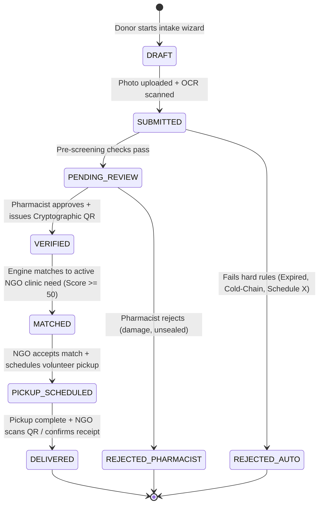

# MedicineLink 💊
### Verified Surplus Medicine Redistribution Platform

[](https://www.typescriptlang.org/)
[](https://react.dev/)
[](https://nodejs.org/)
[](https://expressjs.com/)
[](https://vitejs.dev/)
[](https://tailwindcss.com/)
[](https://sqlite.org/)
[](https://vitest.dev/)
[](LICENSE)

> **⚠️ Educational Prototype Notice:** MedicineLink is an academic engineering prototype developed for *Creativity, Problem Solving & Innovation*. It runs strictly on **synthetic / dummy data**. It is not authorized for real clinical redistribution, real pharmaceuticals, or actual patient care under the Indian Drugs and Cosmetics Act (1940).

---

## 📖 Table of Contents
- [Overview & Problem Statement](#-overview--problem-statement)
- [System Architecture](#-system-architecture)
- [End-to-End Donation Lifecycle](#-end-to-end-donation-lifecycle)
- [Key Features](#-key-features)
- [Quick Start](#-quick-start)
  - [⚡ One-Click Startup (Windows)](#-one-click-startup-windows)
  - [🛠️ Manual Development Setup](#-manual-development-setup)
- [Demo Accounts](#-demo-accounts)
- [3-Minute Live Demo Tour](#-3-minute-live-demo-tour)
- [API Documentation](#-api-documentation)
- [Database Schema & Integrity](#-database-schema--integrity)
- [Testing & Quality Assurance](#-testing--quality-assurance)
- [Security & Regulatory Compliance](#-security--regulatory-compliance)
- [License](#-license)

---

## 🎯 Overview & Problem Statement

Out-of-pocket health expenditure in India accounts for nearly **48% of total health spending**, with pharmaceuticals representing the single largest chunk. Concurrently, millions of unexpired, factory-sealed medicine strips sit unused in urban household cabinets before ending up in landfills.

Existing donation initiatives fail due to:
1. **Lack of Traceability & Clinical Trust:** NGOs cannot accept unchecked medicines from unknown donors.
2. **Expired or Damaged Donations:** High overhead of manually inspecting expired, opened, or temperature-compromised medicines.
3. **Logistics Friction:** Lack of coordinate-based matching between localized supply and real-time clinical need.

**MedicineLink solves this** by introducing a **closed-loop, verified redistribution bridge** connecting Donors, Licensed Pharmacists, and Verified NGOs/Charity Clinics through OCR-assisted intake, automated clinical rule pre-screening, cryptographic QR tracking, and multi-factor geo-matching.

---

## 🏛️ System Architecture

```
                                  MedicineLink Web App
               ┌─────────────────────────────────────────────────────────┐
               │    React 18 + Vite + TypeScript + Tailwind + Framer     │
               └────────────────────────────┬────────────────────────────┘
                                            │ HTTP / JSON
                                            ▼
               ┌─────────────────────────────────────────────────────────┐
               │              Node.js + Express REST API                 │
               │   • JWT Auth & RBAC (Donor, Pharmacist, NGO, Admin)     │
               │   • Zod Request Validation & Pino Structured Logging    │
               │   • Multer + Sharp Image Processing                     │
               │   • Tesseract.js OCR Pre-Screening Engine               │
               │   • 12-Factor Clinical Eligibility Rules Engine         │
               │   • Weighted Proximity Matching Algorithm (Haversine)   │
               │   • Automated Expiry & Sweep Cron Jobs                  │
               └────────────────────────────┬────────────────────────────┘
                                            │
                                            ▼
               ┌─────────────────────────────────────────────────────────┐
               │             Native SQLite Database Engine               │
               │   • 15 Relational Tables with Strict CHECK Constraints  │
               │   • 16 Compound Performance & Partial Unique Indexes    │
               │   • Immutable, Append-Only Audit Triggers               │
               └─────────────────────────────────────────────────────────┘
```

| Layer | Technology | Port / Location | Key Highlights |
| :--- | :--- | :--- | :--- |
| **Frontend** | React 18, Vite, TypeScript, Tailwind CSS | `http://localhost:5173` | Framer Motion, Lenis Smooth Scroll, Embla Carousel, Leaflet Maps, QR Rendering |
| **Backend** | Node.js, Express, TypeScript | `http://localhost:4000` | Native SQLite (`node:sqlite`), Zod validation, Tesseract.js OCR, Swagger UI (`/api/docs`) |
| **Database** | SQLite with WAL mode & strict constraints | `./backend/data/medicinelink.db` | Foreign keys enabled, audit triggers, partial unique indexes (`ux_matches_one_accepted`) |

---

## 🔄 End-to-End Donation Lifecycle



---

## ⚡ Key Features

### 1. Multi-Persona Portals
- **Donor Portal:** Step-by-step donation wizard with live medicine pack presets, photo upload, OCR auto-fill, and Bengaluru coordinate map picker.
- **Pharmacist Review Queue:** Clinical workbench with high-res blister pack inspection, 12-factor safety checklists, approval hotkeys (`A` approve, `R` reject), and dynamic QR issuance.
- **NGO / Charity Clinic Dashboard:** Real-time inventory matching, compatibility score rings (0–100), delivery pickup scheduler, and receipt confirmation.
- **Admin Command Center:** High-level platform analytics (Bento metrics, Recharts trends, rejection breakdown), NGO verification management, CSV data export, and append-only audit trail exploration.

### 2. Intelligent OCR & 12-Factor Clinical Pre-Screening
- Extracts **Batch Number**, **Expiry Date**, and **Manufacturer** from blister pack packaging using Tesseract.js and Sharp image normalization.
- **Deterministic Hard Rules Engine:**
  - ⛔ **Not Expired:** Rejects medicines past their expiry date.
  - ⛔ **Minimum Shelf Life:** Rejects items with $< 6$ months remaining shelf life.
  - ⛔ **Cold-Chain Prohibition:** Rejects insulin, vaccines, or temperature-sensitive biologicals.
  - ⛔ **Controlled Substances:** Blocks Schedule X, narcotics, sedatives, and psychiatric drugs.
  - ⛔ **Packaging Integrity:** Rejects cut strips, loose capsules, or unsealed syrups.

### 3. Weighted Multi-Factor Matching Algorithm
Calculates a 0–100 compatibility score between verified donations and NGO requirements:
$$\text{Score} = \text{Medicine Match (50 pts)} + \text{Proximity (30 pts)} + \text{NGO Urgency (20 pts)}$$
- **Proximity:** Calculated using the Haversine spherical distance formula (max radius 15 km).
- **First-Accept Wins:** Enforced via SQLite partial unique index (`ux_matches_one_accepted`) to eliminate race conditions between multiple recipient NGOs.

---

## 🚀 Quick Start

### ⚡ One-Click Startup (Windows)
Double-click [`start.bat`](file:///d:/PROJECTS/Medicine%20Link/start.bat) in the repository root.
It will automatically:
1. Verify Node.js and npm prerequisites.
2. Initialize `backend/.env` from `.env.example`.
3. Install dependencies for both Frontend and Backend if missing.
4. Run SQLite schema migrations and populate sample seed data.
5. Launch both server windows and health-check the dev server before opening `http://localhost:5173`.

---

### 🛠️ Manual Development Setup

#### Prerequisites
- **Node.js** v18.0.0 or higher (Node v20+ or v22+ recommended)
- **npm** v9+

#### 1. Backend API Setup
```bash
cd backend
npm install

# Copy environment variables
cp .env.example .env

# Run database migrations and seed demo data
npm run db:migrate
npm run db:seed

# Start backend server in development mode
npm run dev
```
- **API URL:** `http://localhost:4000`
- **Health Check:** `http://localhost:4000/api/v1/health`
- **Swagger OpenAPI Docs:** `http://localhost:4000/api/docs`

#### 2. Frontend Web App Setup
```bash
cd frontend
npm install

# Start Vite dev server
npm run dev
```
- **Web App URL:** `http://localhost:5173`

---

## 👥 Demo Accounts

The database comes pre-seeded with sample users for all roles.
**Password for all accounts:** `Demo@1234`

| Role | Name | Email | Organization | Status |
| :--- | :--- | :--- | :--- | :--- |
| **Donor** | Aarav Sharma | `aarav.donor@demo.medicinelink.org` | Household Donor | Active |
| **Pharmacist** | Dr. Meera Nair (RPh) | `meera.rx@greencross.demo.org` | GreenCross Pharmacy | Verified Verifier |
| **NGO / Clinic** | Rohan Deshmukh | `rohan@ashahealth.demo.org` | Asha Health Foundation | Verified Partner |
| **Clinic** | Dr. Ananya Rao | `ananya@carestreet.demo.org` | Care Street Clinic | Verified Partner |
| **Unverified NGO**| Sanjay Mehta | `sanjay@hopehelpers.demo.org` | Hope Helpers Trust | Pending Admin Review |
| **Platform Admin**| Priya Krishnan | `admin@medicinelink.demo.org` | MedicineLink Central | Full Access |

---

## 🎬 3-Minute Live Demo Tour

Follow these steps to experience the complete platform flow:

1. **Landing Page (`/`):**
   - Check out the floating parallax hero capsules, animated problem counters, 6-step interactive workflow, and self-drawing SVG acceptance criteria.
2. **Donor Intake Wizard (`/donor/new`):**
   - Click the **Valid Pack (Dolo 650 · 18m left)** quick-preset to test the animated laser scan OCR extraction.
   - Test the **Short Expiry** or **Cold-Chain (Insulin Pen)** presets in Step 3 to see the rule engine block ineligible items with clear explanations.
   - Submit the valid donation with a Bengaluru map coordinate pin.
3. **Pharmacist Review (`/pharmacist/review`):**
   - Switch persona to **Pharmacist** using the top navbar switcher.
   - Inspect the blister pack photo and 12-factor safety checklist.
   - Press hotkey **`A`** (or click **Approve & Generate QR**) to approve the medicine and generate its cryptographic verification token.
4. **NGO Matching & Acceptance (`/ngo/dashboard`):**
   - Switch persona to **NGO / Clinic**.
   - Inspect the **Score Ring (100/100)** to see the 50/30/20 point scoring breakdown.
   - Accept the match, schedule a pickup, and click **Confirm Received 🎉** to trigger the completion confetti celebration!
5. **Admin Impact & Audit Trail (`/admin/dashboard`):**
   - Switch persona to **Admin**.
   - Review platform statistics, verify the pending NGO ("Hope Helpers Trust"), and query the immutable append-only audit trail.

---

## 📡 API Documentation

Interactive Swagger OpenAPI 3.0 documentation is available at `http://localhost:4000/api/docs`.

### Key Endpoints

| Method | Endpoint | Description | Access |
| :--- | :--- | :--- | :--- |
| `GET` | `/api/v1/health` | Service health status, database ping, uptime | Public |
| `POST` | `/api/v1/auth/login` | Authenticate and obtain JWT access & refresh tokens | Public |
| `GET` | `/api/v1/auth/me` | Fetch authenticated user profile and roles | Authenticated |
| `POST` | `/api/v1/donations` | Create a new donation batch | Donor |
| `POST` | `/api/v1/donations/ocr` | Perform OCR scanning on packaging image | Donor |
| `GET` | `/api/v1/review/queue` | Fetch donations pending clinical verification | Pharmacist |
| `POST` | `/api/v1/review/:id/approve` | Approve donation and issue cryptographic QR token | Pharmacist |
| `POST` | `/api/v1/review/:id/reject` | Reject donation with clinical rejection reason | Pharmacist |
| `GET` | `/api/v1/needs/matches` | Get ranked matching donations for an NGO | NGO / Clinic |
| `POST` | `/api/v1/matches/:id/accept` | Accept a matched donation (concurrency-safe) | NGO / Clinic |
| `POST` | `/api/v1/pickups/:id/receive` | Confirm receipt and mark donation as DELIVERED | NGO / Clinic |
| `GET` | `/api/v1/admin/stats` | Aggregated platform metrics and redistribution data | Admin |
| `GET` | `/api/v1/admin/audit-logs` | Query tamper-evident system audit logs | Admin |

---

## 🗄️ Database Schema & Integrity

The database architecture is designed with defensive constraints and auditability:
- **15 Normalized Tables:** `users`, `organisations`, `donations`, `donation_items`, `needs`, `matches`, `pickups`, `pharmacist_verifications`, `audit_logs`, `settings`, `blocked_medicines`, `medicine_aliases`, etc.
- **Strict CHECK Constraints:** Status state machines, positive quantities, and ISO-8601 `YYYY-MM-DD` date validation.
- **Race Condition Prevention:** Partial unique index `ux_matches_one_accepted` ensures that an item cannot be accepted by more than one recipient organization simultaneously.
- **Immutable Audit Triggers:** Append-only triggers record before/after state modifications across all critical tables.

---

## 🧪 Testing & Quality Assurance

MedicineLink includes an automated Vitest test suite testing database constraints, state machine transitions, clinical rule evaluation, and API endpoints.

```bash
cd backend
npm test
```

### Test Suite Highlights:
- ✅ **Database Acceptance Tests:** Validates CHECK constraints, negative quantities, date formats, and unique indexes.
- ✅ **State Machine Validation:** Ensures valid state progression and blocks illegal status skips (e.g. `DRAFT -> DELIVERED`).
- ✅ **12-Factor Rules Engine:** Verifies rejection of cold-chain, Schedule X, and short shelf-life medicines.
- ✅ **Matching Scoring Tests:** Asserts accurate mathematical weight calculation (Medicine + Distance + Urgency).
- ✅ **Automated Cron Jobs:** Tests scheduled expiry transitions and match expirations.

---

## 🛡️ Security & Regulatory Compliance

- **Authentication:** Dual-token JWT (short-lived access token + httpOnly refresh token) with `bcryptjs` password hashing (salt rounds = 10).
- **Transport Security:** HTTP security headers powered by `helmet`, CORS domain whitelisting, and strict upload size limits via `multer`.
- **Indian Pharmaceutical Regulations:** Developed in consideration of:
  - **Drugs and Cosmetics Act, 1940 & Rules, 1945:** Strict prohibition on unlicensed stocking and sale; adherence to mandatory pharmacist supervision.
  - **Schedule H / H1 / X Regulations:** Active filtering preventing illicit handling of restricted and prescription-only substances.
  - **Cold-Chain Assurance:** Automatic disqualification of medicines requiring temperature-controlled logistics (2°C–8°C).

---

## 📄 License

This project is licensed under the [MIT License](LICENSE) — see the LICENSE file for details.
